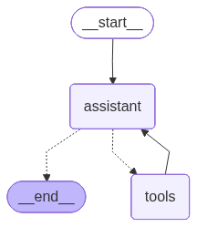

# FAQ Chatbot

An AI-powered CLI chatbot that answers customer questions based on a predefined FAQ document. Built with Python, LangChain, and LangGraph using the ReAct (Reasoning + Acting) pattern.

---

## How It Works

The chatbot follows a **ReAct loop**: the LLM reasons about the user's question, decides whether to call a tool to fetch FAQ data, and then formulates a natural-language response. The conversation history is retained in memory for the duration of the session, so the bot can recognise repeated questions and avoid unnecessary tool calls.



### Control flow

```
User input
     │
     ▼
 assistant_node  ◄───────────────────────────────┐
 LLM reads history + system prompt               │
 and decides next step                           │
     │                                           │
     ├─ tool call needed? ──► tools_node         │
     │                        runs get_faqs()    │
     │                        returns FAQ list ──┘
     │
     └─ (no tool call needed) ──► print final answer ──► END
```

1. **`assistant_node`**: sends the conversation history (limited to the last 10 messages) together with the system prompt to the LLM. The LLM either returns a final answer or requests the `get_faqs` tool.
2. **`tools_node`**: executes `get_faqs`, which reads `data/faqs.json` and returns all question/answer pairs to the LLM.
3. The LLM receives the FAQ data and formulates a response in the user's language, based solely on the FAQ content.

---

## Language Model — Choice and Justification

Three providers were evaluated. The comparison below covers cost and the privacy aspects most relevant to a customer-facing web chatbot.

| Provider | Model | Cost per 1M tokens | Data Protection |
|---|---|---|---|
| Google | gemini-2.0-flash-preview | Input: $0.50 · Output: $3.00 | Prompts and outputs are not used for model training. Data is logged temporarily for security, abuse detection, and legal compliance. Data collected: prompts, outputs, IP address, device data, usage metrics. Processing: global. |
| OpenAI | gpt-4o-mini | Input: $0.25 · Output: $2.00 | Prompts and outputs are not used for training. Data collected: prompts, outputs, account data, technical metadata (IP, device, usage). Usage: service operation, security, abuse prevention. Processing: global (incl. US) with safeguards. Data deletion, export, and opt-out options available. |
| **Mistral** | **mistral-small-latest** | **Input: $0.15 · Output: $0.60** | Prompts and outputs are not used for model training. Storage: typically up to 30 days for abuse monitoring. Data collected: prompts, outputs, technical data (IP, usage), account data. Processing: primarily EU-focused (GDPR-aligned), transfers outside EU only with safeguards. |

### Decision: Mistral `mistral-small-latest`

**Cost:** Mistral is the most cost-effective option.

**Privacy:** All three providers state that prompts and outputs are not used for model training. Mistral stands out by being GDPR-aligned by default with EU-focused data processing and transfers outside the EU only with safeguards.

**Assumption:** It is assumed that users do not enter personal data. The chatbot is presented on the website as an FAQ assistant only, with no login and a note that only FAQ-related questions are handled. This limits privacy exposure regardless of provider.  I have now decided on Mistral Small due to the cost. 

---

## Docker & Running

```bash
#Build and run with Docker Compose
docker compose up --build  
docker compose run faq-chatbot
```

Type your question and press Enter. Type `exit` to quit.


---

## Tests

Tests run without an API key and without any network access (fake LLM).

```bash
# Install dev dependencies (once)
uv sync --group dev

# Run tests
uv run pytest tests/ -v
```

---

## Configuration

All settings are in `src/config.py`:

| Variable | Default | Description |
|---|---|---|
| `LLM_MODEL` | `mistral-small-latest` | Mistral model to use |
| `LLM_TEMPERATURE` | `0.3` | Response randomness (0 = deterministic) |
| `MAX_HISTORY_MESSAGES` | `10` | How many past messages are sent to the LLM per turn |

